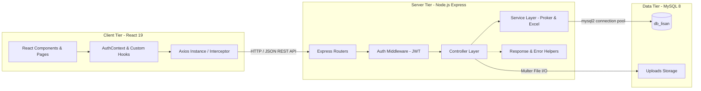
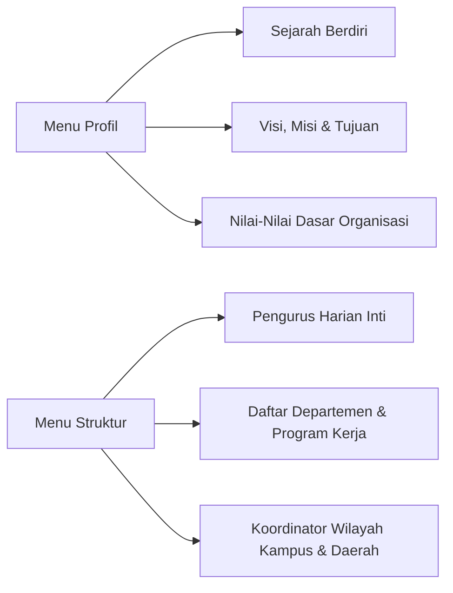
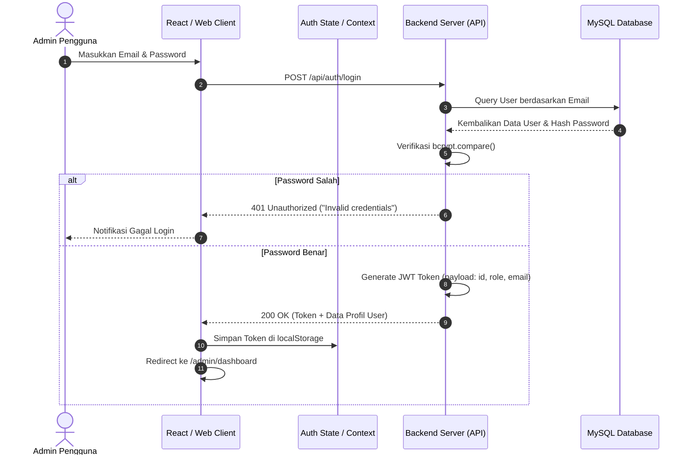
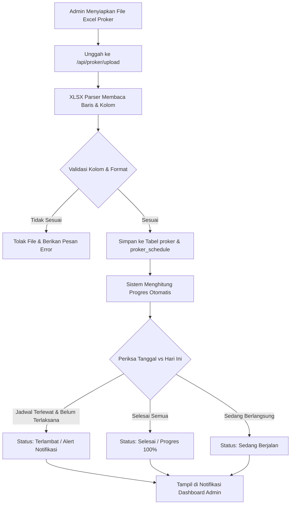
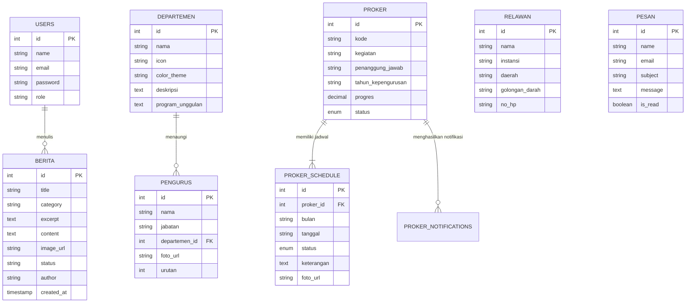

# Dokumentasi Alur & Arsitektur Sistem Website LISAN
**Lingkar Mahasiswa Islam untuk Perubahan (LISAN) - Kabupaten Sidenreng Rappang**

Dokumen ini menjelaskan arsitektur teknis **Fullstack JavaScript**, alur kerja (*user flow*), struktur data, hak akses, serta proses bisnis yang ada di dalam website LISAN, baik untuk pengunjung publik maupun administrator.

---

## 1. Arsitektur Teknis Fullstack JavaScript (Client-Server)

Sistem LISAN dibangun 100% menggunakan ekosistem **Modern JavaScript**:



---

## 2. Diagram Alur Utama (System Flow Overview)

```mermaid
flowchart TD
    User([Pengunjung / Pengguna]) --> Landing[Akses Website Utama]
    
    Landing --> PublicFlow{Pilihan Navigasi}
    
    %% Alur Publik
    PublicFlow -->|Tentang Kami| Profile[Profil: Sejarah, Visi Misi, Nilai Organisasi]
    PublicFlow -->|Struktur| OrgStructure[Struktur Pengurus & Departemen & Korwil]
    PublicFlow -->|Kegiatan| Programs[Program Kerja & Matriks Jadwal Proker]
    PublicFlow -->|Publikasi| Media[Berita, Artikel & Galeri Dokumentasi]
    PublicFlow -->|Partisipasi| Action[Donor Darah, Pendaftaran Relawan & Kontak Kami]
    
    %% Alur Admin
    Landing -->|Halaman Khusus| Login[/admin atau /login]
    Login --> AuthCheck{Autentikasi JWT}
    AuthCheck -->|Gagal| LoginError[Tampilkan Pesan Error]
    LoginError --> Login
    AuthCheck -->|Berhasil| Dashboard[Admin Dashboard Overview]
    
    Dashboard --> AdminMgmt{Menu Manajemen}
    AdminMgmt --> ManageNews[Manajemen Berita & Artikel]
    AdminMgmt --> ManageProker[Manajemen Proker & Unggah Excel Matriks]
    AdminMgmt --> ManageGallery[Manajemen Foto Galeri]
    AdminMgmt --> ManageRelawan[Data Relawan & Donor Darah]
    AdminMgmt --> ManageKader[Database Kader Organisasi]
    AdminMgmt --> ManageInbox[Kotak Masuk Pesan & Aspirasi]
    AdminMgmt --> ManageSettings[Pengaturan Hero & Kontak Website]
```

---

## 2. Alur Pengunjung Publik (Public User Journey)

### 2.1. Beranda (Landing Page)
1. **Hero Carousel**: Menampilkan slide banner utama dengan pesan visi perubahan dan tombol Call-to-Action (CTA) "Bergabung Bersama Kami" dan "Jelajahi Program".
2. **Statistik Organisasi**: Ringkasan jumlah kader, departemen, program terlaksana, dan wilayah cabang.
3. **Sorotan Program & Berita Terkini**: Menampilkan 3-4 program unggulan dan artikel terbaru dari database.
4. **Matriks Proker Terbuka**: Pengunjung dapat melihat timeline pelaksanaan program kerja tahun kepengurusan aktif secara transparan.

### 2.2. Profil & Struktur Organisasi


### 2.3. Partisipasi & Interaksi Masyarakat
- **Pendaftaran Relawan**: Formulir publik untuk masyarakat/mahasiswa yang ingin bergabung dalam kegiatan sosial dan kemanusiaan.
- **Donor Darah**: Pendataan calon pendonor darah untuk kegiatan rutin LISAN Tanggap Kemanusiaan.
- **Form Kontak / Aspirasi**: Pengunjung dapat mengirimkan pertanyaan, saran, atau kerjasama kemitraan yang langsung masuk ke panel admin.

---

## 3. Alur Autentikasi & Keamanan (Security Flow)



---

## 4. Alur Khusus: Manajemen Program Kerja (Proker Matrix & Excel Engine)

Fitur paling kompleks dalam website LISAN adalah pengelolaan Program Kerja dengan matriks kalender dan impor berkas Excel.



---

## 5. Struktur Database (Entity Relationship Overview)



---

## 6. Hak Akses & Peran Pengguna (Role-Based Access Control)

| Modul Fitur | Pengunjung Publik | Editor | Administrator Utama |
| :--- | :---: | :---: | :---: |
| Membaca Berita, Profil, Struktur, Galeri | :white_check_mark: | :white_check_mark: | :white_check_mark: |
| Mengirim Pesan / Mendaftar Relawan | :white_check_mark: | :white_check_mark: | :white_check_mark: |
| Melihat Matriks Timeline Proker Publik | :white_check_mark: | :white_check_mark: | :white_check_mark: |
| Membuat & Mengedit Berita / Galeri | :x: | :white_check_mark: | :white_check_mark: |
| Unggah File Excel Proker & Ubah Jadwal | :x: | :white_check_mark: | :white_check_mark: |
| Manajemen Data Kader & Relawan | :x: | :white_check_mark: | :white_check_mark: |
| Pengaturan Akun Admin & Hero Slides | :x: | :x: | :white_check_mark: |
| Mengubah Pengaturan Kontak Organisasi | :x: | :x: | :white_check_mark: |
